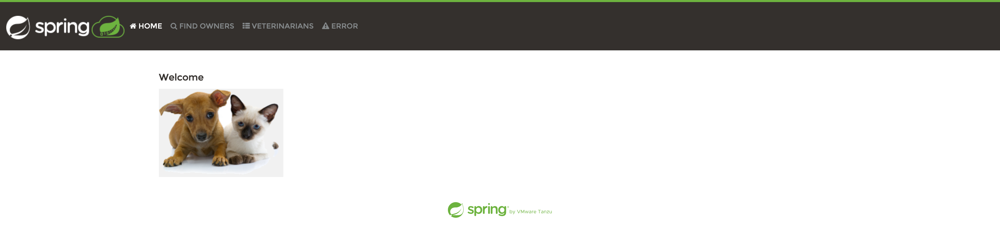
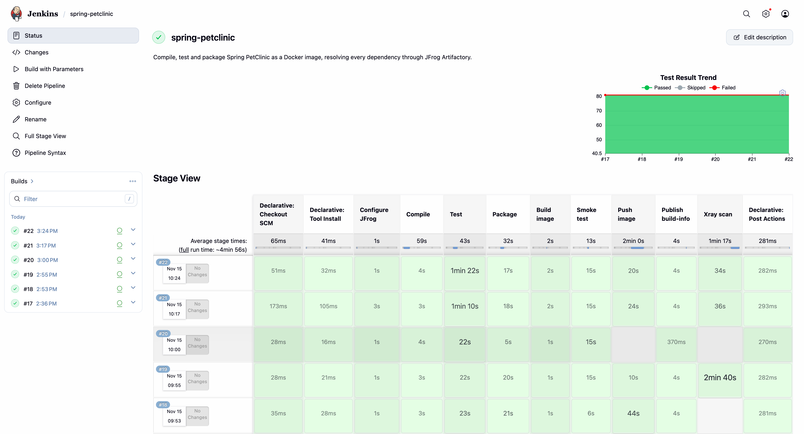
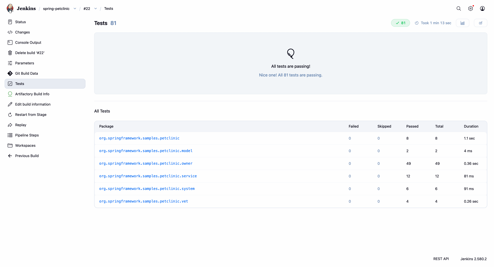
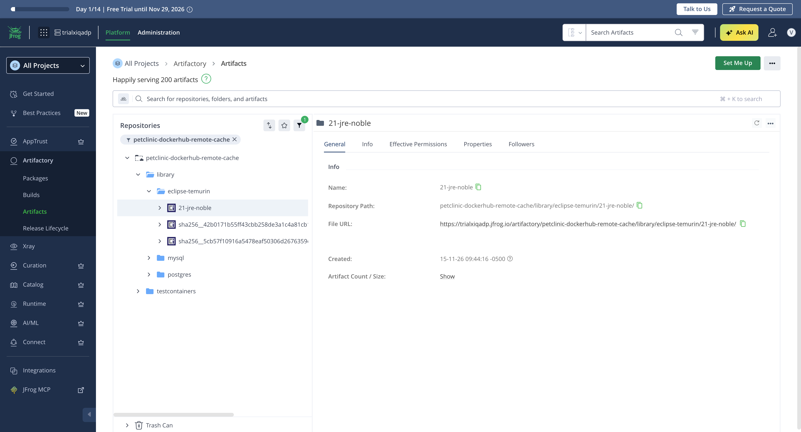
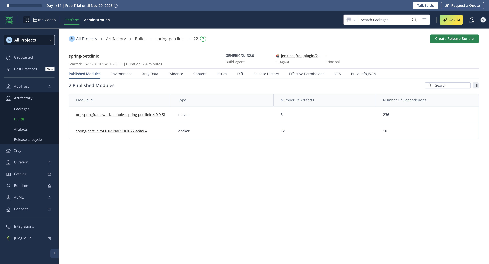
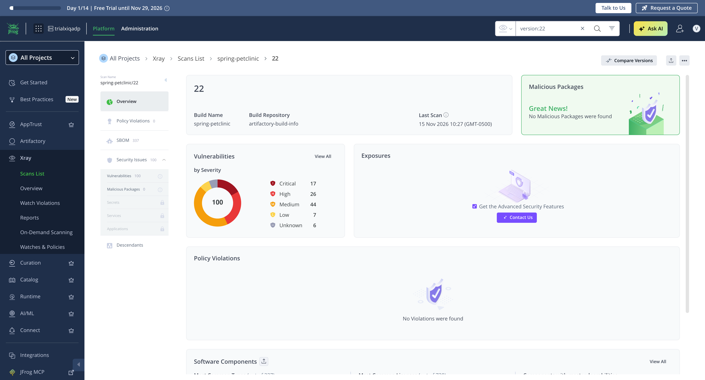

# Spring PetClinic: Jenkins pipeline with JFrog Artifactory

A fork of [spring-petclinic](https://github.com/spring-projects/spring-petclinic). The
[Jenkinsfile](Jenkinsfile) compiles, tests and packages the app as a Docker image
([Dockerfile](Dockerfile)) using the JFrog plugin and `jf` CLI, with every build dependency
resolved through JFrog Cloud. Jenkins runs in Docker from [jenkins/](jenkins/), configured as code.

## Run the image

Download `spring-petclinic-4.0.0-SNAPSHOT-linux-amd64.tar.gz` from
[Releases](https://github.com/vinceoan/spring-petclinic-jfrog/releases/latest), then:

```bash
docker load -i spring-petclinic-4.0.0-SNAPSHOT-linux-amd64.tar.gz
docker run --rm -p 8080:8080 spring-petclinic:4.0.0-SNAPSHOT
```

Open http://localhost:8080 (health at `/actuator/health`).



## Pipeline

1. Configure JFrog: `jf rt ping`, `jf mvn-config`, Docker login to JFrog Cloud.
2. Compile: `jf mvn clean compile`.
3. Test: `jf mvn test`, 81 tests including the MySQL and PostgreSQL integration tests.
4. Package: `jf mvn install -DskipTests` deploys the jar to `petclinic-maven-snapshot-local`.
5. Build image: copies that jar onto the Temurin 21 JRE (layered, non-root, `HEALTHCHECK`).
6. Smoke test: [scripts/smoke-test.sh](scripts/smoke-test.sh) waits for the health check, then
   checks two pages.
7. Push image: `jf docker push` to `petclinic-docker-local`.
8. Publish build-info, then an optional Xray scan.





## Dependencies through JFrog

[scripts/setup-jfrog-cloud.sh](scripts/setup-jfrog-cloud.sh) creates the repositories:

- `petclinic-maven`: virtual over a Maven Central remote and release/snapshot locals. Serves
  dependencies and plugins (`jf mvn-config`) and Maven itself for `./mvnw` (`MVNW_REPOURL`).
- `petclinic-jfrog-releases-remote`: proxies releases.jfrog.io for the build-info extractor that
  `jf mvn` downloads (`JFROG_CLI_RELEASES_REPO`).
- `petclinic-docker`: virtual over a Docker Hub remote and `petclinic-docker-local`. Serves the
  base image (`BASE_REGISTRY`) and the test images (`TESTCONTAINERS_HUB_IMAGE_NAME_PREFIX`,
  `COMPOSE_IMAGE_PREFIX`).

The Docker Hub remote after a build:



Build-info links the jar, pom, SBOM, 236 Maven dependencies and the image to the git commit.



The Xray scan finds no malicious packages, and the vulnerabilities it reports are mostly in upstream
dependencies. It runs with `--fail=false`, so it reports without failing the build.



## Run the pipeline yourself

You need Docker with Compose (6 GB of memory), free ports 8088 and 5432, and a JFrog Cloud trial.

1. Create the repositories with an admin-scoped access token (Administration > User Management >
   Access Tokens):
   ```bash
   git clone https://github.com/vinceoan/spring-petclinic-jfrog.git && cd spring-petclinic-jfrog
   JFROG_URL=https://<name>.jfrog.io scripts/setup-jfrog-cloud.sh   # asks for the token
   ```
2. Start Jenkins. `JFROG_USER` is your JFrog user name (on a trial, usually the sign-up email)
   and `JFROG_ACCESS_TOKEN` can be an identity token of that user (Edit Profile > Generate an
   Identity Token).
   ```bash
   cd jenkins
   cp .env.example .env   # set JENKINS_ADMIN_PASSWORD, JFROG_URL, JFROG_USER, JFROG_ACCESS_TOKEN
   docker compose up -d --build
   ```
   On Linux also set `DOCKER_GID` in `.env`. After editing `.env`, run
   `docker compose up -d --force-recreate`.
3. Open http://localhost:8088, sign in as `admin` and run `spring-petclinic` with Build with
   Parameters. Configuration as Code already created the job, which builds `main` of this clone.
   Parameters: `ARTIFACTORY_TARGET` (`cloud` or `selfhosted`), `IMAGE_PLATFORM` (`linux/amd64` or
   `linux/arm64`), `XRAY_SCAN` (after the first build, add `spring-petclinic` to Xray's indexed
   builds). Results show in the Jenkins Tests tab and under Artifactory > Builds.

## Self-hosted Artifactory

From the repo root (needs port 8082 and about 2 GB more memory):

```bash
cd selfhosted-artifactory
cp .env.example .env    # set ARTIFACTORY_DB_PASSWORD, ARTIFACTORY_ADMIN_PASSWORD
docker compose up -d && ./setup-repos.sh    # first start takes a few minutes
```

Put the `JFROG_SELFHOSTED_TOKEN` line that `setup-repos.sh` prints into `jenkins/.env`, recreate
Jenkins and build with `ARTIFACTORY_TARGET=selfhosted`. Maven, the jar and build-info then use the
self-hosted instance (UI at http://localhost:8082/ui/). OSS has no Docker support, so images still
come through JFrog Cloud and the image is not pushed.
